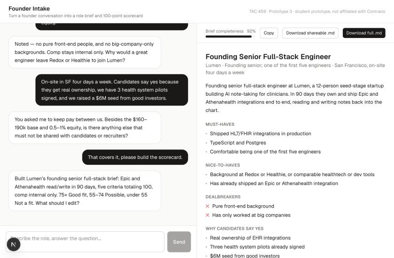
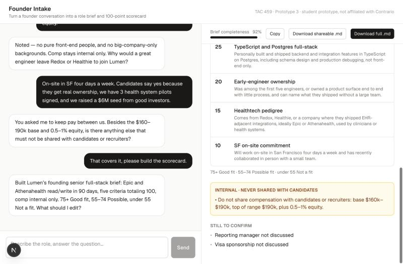

# Founder Intake: TAC 459 Capstone, Prototype 3

**A chat that turns a founder's messy hiring notes into a clear role brief and a 100-point scorecard.**

Built for [Contrario](https://contrario.ai) (YC W25) as part of USC's TAC 459 Generative AI & NLP capstone.

> Student prototype. Not affiliated with or endorsed by Contrario.

**Status:** lightweight prototype. Tested end to end against the live Grok API with a scripted six-turn founder conversation (scorecard weights totalled 100, and the confidential pay figure stayed out of every shareable field). Not yet tested with real founders.

## Screenshots





## What it does

1. The founder describes a role in plain language.
2. The AI asks one follow-up at a time and pushes back on vague answers ("strong engineer" becomes "which company would you hire from?").
3. A brief builds live beside the chat: must-haves, dealbreakers, compensation, why candidates say yes.
4. Confidential details go to an internal section that is stripped from the shareable export. Anything the founder did not say is flagged under "Still to confirm" instead of invented.
5. It ends with a scorecard of 4-5 criteria worth 100 points (75+ Good fit, 55-74 Possible fit, under 55 Not a fit), the same style as Prototype 2.

The exported `.md` brief is meant to feed Prototype 1 (Role Brief Copilot).

Documents:
- [Founder-Intake-Overview.pdf](Founder-Intake-Overview.pdf): plain-language overview of this product.
- [docs/Contrario-Capstone-Three-Prototypes.pdf](docs/Contrario-Capstone-Three-Prototypes.pdf): Dec 2 submission document covering all three prototypes (code links and screenshots). Source: [docs/submission.html](docs/submission.html).

The example brief in the overview is hand-written for illustration, not real model output.

## How it works

`src/app/api/intake/route.ts` sends the conversation to the Grok API (xAI, OpenAI-compatible) and forces a structured function call that returns the next message plus the full updated brief. `src/lib/brief.ts` validates the result with zod and rescales scorecard weights so they always total 100.

## Run it

```bash
git clone https://github.com/armansahi/TAC459-Prototype-3.git
cd TAC459-Prototype-3
npm install
cp .env.example .env.local   # add your Grok key
npm run dev                  # http://localhost:3000
```

`.env.local` is git-ignored. Variables match Prototype 1: `XAI_API_KEY`, `XAI_BASE_URL`, `GROK_MODEL`.

## Layout

```
src/app/page.tsx              Chat + live brief UI
src/app/api/intake/route.ts   Grok call (structured output)
src/lib/brief.ts              Brief schema, scorecard normalization, markdown export
artifact/                     Overview page (index.html) and a Claude-powered live demo
```
